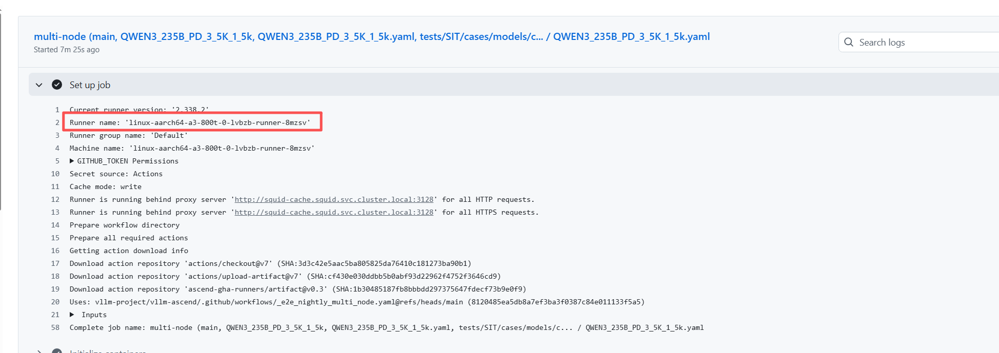

# 同步工具 (sync-tools) 说明

## 项目概述

本项目通过[skopeo](https://github.com/containers/skopeo)将各种昇腾可用的镜像从主要的[发布 registry](https://quay.io/organization/ascend/)同步到各种[registry]，方便用户就近下载使用。

同时支持模型和数据集同步到多个 NPU 集群，两种模式：

- **按请求 model library**（**业务方走这个**，详见下文「模型下载（model library）」一节）：在 `model-requests/requests.json` 追加一条请求对象即可提 PR——**从自己 fork 提也生效**（不执行 fork 代码）；或在业务 CI 里调 API。按 (repo, runner 标签) 自动路由到对应集群共享盘并自动记台账。
- **按项目常态同步**（runner 维护方配置，业务方**不要**为此改这些文件）：每个项目在 `config/projects/<name>.json` 维护常驻清单，无需新增 workflow。

## 包含的镜像（在哪下载）

从使用者角度整理：想知道某个镜像去哪拉，按地域就近选。同一镜像的不同版本各占一行；「—」表示该地域没有。同步源地址与 tag 过滤规则以 [`.github/workflows/config/image-sync.json`](.github/workflows/config/image-sync.json) 为准。

|镜像|国外（quay.io / docker.io）|国内（SWR）|香港（SWR）|说明|
|---|---|---|---|---|
|[vllm-ascend](https://github.com/vllm-project/vllm-ascend)|`quay.io/ascend/vllm-ascend`<br>`docker.io/ascendai/vllm-ascend`|`swr.cn-southwest-2.myhuaweicloud.com/base_image/ascend-ci/vllm-ascend/vllm-ascend`<br>`swr.cn-east-3.myhuaweicloud.com/upupup/ascend-ci/vllm-ascend/vllm-ascend`|—|正式版|
|vllm-ascend（每日构建）|—|`swr.cn-east-3.myhuaweicloud.com/upupup/ascend-ci/vllm-ascend/vllm-ascend-daily`|—|每日构建版本|
|vllm-ascend（CI 构建）|`quay.io/atlas-ci/vllm-ascend`|`swr.cn-southwest-2.myhuaweicloud.com/base_image/ascend-ci/vllm-ascend/vllm-ascend-ci`|—|CI 构建版本|
|vllm-ascend（lint）|—|—|`swr.ap-southeast-1.myhuaweicloud.com/base_image/ascend-ci/vllm-ascend/vllm-ascend`|仅 `lint` tag|
|vllm-ascend（北四）|—|`swr.cn-north-4.myhuaweicloud.com/inference/vllm-ascend`|—|北四地域版本|
|[sglang](https://github.com/sgl-project/sglang)|`quay.io/ascend/sglang`|`swr.cn-southwest-2.myhuaweicloud.com/base_image/dockerhub/lmsysorg/sglang`|—|仅同步含 `cann` 的 tag|
|[verl](https://github.com/verl-project/verl)|`quay.io/ascend/verl`<br>`docker.io/ascendai/verl`|`swr.cn-southwest-2.myhuaweicloud.com/base_image/ascend-ci/verl/verl`<br>`swr.cn-southwest-2.myhuaweicloud.com/modelfoundry/ascend-ci/verl/verl`|`swr.ap-southeast-1.myhuaweicloud.com/base_image/ascend-ci/verl/verl`|—|
|[llamafactory](https://github.com/hiyouga/LlamaFactory)|`quay.io/ascend/llamafactory`<br>`docker.io/ascendai/llamafactory`|`swr.cn-southwest-2.myhuaweicloud.com/base_image/ascend-ci/llamafactory/llamafactory`|—|—|
|[ms-swift](https://github.com/modelscope/ms-swift)|`quay.io/ascend/ms-swift`<br>`docker.io/ascendai/ms-swift`|—|—|—|
|[cann](https://gitcode.com/cann)|`quay.io/ascend/cann`<br>`docker.io/ascendai/cann`|`swr.cn-southwest-2.myhuaweicloud.com/base_image/ascend-ci/cann/cann`|—|—|
|cann（atlas_inference）|`quay.io/atlas_inference/cann`|—|`swr.ap-southeast-1.myhuaweicloud.com/base_image/ascend-ci/atlas_inference/cann`|日期版本 tag（`2026.xx.xx-*`）|
|[mindie](https://www.hiascend.com/software/mindie)|`quay.io/ascend/mindie`<br>`docker.io/ascendai/mindie`|—|—|—|
|mindie-motor|`quay.io/ascend/mindie-motor`<br>`docker.io/ascendai/mindie-motor`|—|—|—|
|mindiesd|`quay.io/ascend/mindiesd`<br>`docker.io/ascendai/mindiesd`|—|—|—|
|mindspeed-llm|`quay.io/ascend/mindspeed-llm`<br>`docker.io/ascendai/mindspeed-llm`|—|—|—|
|mindspeed-mm|`quay.io/ascend/mindspeed-mm`<br>`docker.io/ascendai/mindspeed-mm`|—|—|—|
|mindspeed-core|`quay.io/ascend/mindspeed-core`<br>`docker.io/ascendai/mindspeed-core`|—|—|—|
|mindspeed-ops|`quay.io/ascend/mindspeed-ops`<br>`docker.io/ascendai/mindspeed-ops`|—|—|—|
|mindformers|`quay.io/ascend/mindformers`<br>`docker.io/ascendai/mindformers`|—|—|—|
|mindspore|`quay.io/ascend/mindspore`<br>`docker.io/ascendai/mindspore`|—|—|—|
|[pytorch](https://gitcode.com/ascend/pytorch)|`quay.io/ascend/pytorch`<br>`docker.io/ascendai/pytorch`|`swr.cn-southwest-2.myhuaweicloud.com/base_image/ascend-ci/pytorch/pytorch`|—|—|
|torch-npu|`quay.io/ascend/torch-npu`<br>`docker.io/ascendai/torch-npu`|—|—|—|
|python|`quay.io/ascend/python`<br>`docker.io/ascendai/python`|`swr.cn-southwest-2.myhuaweicloud.com/base_image/ascend-ci/python/python`|—|—|
|manylinux|`quay.io/ascend/manylinux`<br>`docker.io/ascendai/manylinux`|`swr.cn-southwest-2.myhuaweicloud.com/base_image/ascend-ci/manylinux/manylinux`|—|—|
|[triton-ascend](https://gitcode.com/ascend/triton-ascend)|`quay.io/ascend/triton`<br>`docker.io/ascendai/triton`|`swr.cn-southwest-2.myhuaweicloud.com/base_image/ascend-ci/triton/triton`|—|—|
|[tilelang-ascend](https://github.com/tile-ai/tilelang-ascend)|—|`swr.cn-southwest-2.myhuaweicloud.com/base_image/ascend-ci/tilelang/tilelang-ascend`|—|—|
|vllm-omni|`quay.io/ascend/vllm-omni`<br>`docker.io/ascendai/vllm-omni`|`swr.cn-southwest-2.myhuaweicloud.com/base_image/ascend-ci/vllm-omni/vllm-omni`|—|—|
|[veomni](https://github.com/ByteDance-Seed/VeOmni)|`quay.io/ascend/veomni`<br>`docker.io/ascendai/veomni`|`swr.cn-southwest-2.myhuaweicloud.com/base_image/ascend-ci/veomni/veomni`|—|—|
|roll|`quay.io/ascend/roll`<br>`docker.io/ascendai/roll`|—|—|—|
|slime-ascend|`quay.io/ascend/slime-ascend`<br>`docker.io/ascendai/slime-ascend`|—|—|—|
|xllm-ai|—|`swr.cn-southwest-2.myhuaweicloud.com/base_image/ascend-ci/xllm-ai/xllm-ai`|—|仅同步 `a2` / `a3` / `release` tag|
|visionsdk|`quay.io/ascend/visionsdk`<br>`docker.io/ascendai/visionsdk`|—|—|—|
|ragsdk|`quay.io/ascend/ragsdk`<br>`docker.io/ascendai/ragsdk`|—|—|—|
|indexsdk|`quay.io/ascend/indexsdk`<br>`docker.io/ascendai/indexsdk`|—|—|—|
|multimodalsdk|`quay.io/ascend/multimodalsdk`<br>`docker.io/ascendai/multimodalsdk`|—|—|—|
|drivingsdk|`quay.io/ascend/drivingsdk`<br>`docker.io/ascendai/drivingsdk`|—|—|—|
|model-agent|`quay.io/ascend/model-agent`<br>`docker.io/ascendai/model-agent`|—|—|—|
|ascend-k8sdeviceplugin|`quay.io/ascend/ascend-k8sdeviceplugin`<br>`docker.io/ascendai/ascend-k8sdeviceplugin`|—|—|—|
|ascend-operator|`quay.io/ascend/ascend-operator`<br>`docker.io/ascendai/ascend-operator`|—|—|—|
|npu-exporter|`quay.io/ascend/npu-exporter`<br>`docker.io/ascendai/npu-exporter`|—|—|—|
|noded|`quay.io/ascend/noded`<br>`docker.io/ascendai/noded`|—|—|—|
|clusterd|`quay.io/ascend/clusterd`<br>`docker.io/ascendai/clusterd`|—|—|—|
|vc-scheduler|`quay.io/ascend/vc-scheduler`<br>`docker.io/ascendai/vc-scheduler`|—|—|—|
|vc-controller-manager|`quay.io/ascend/vc-controller-manager`<br>`docker.io/ascendai/vc-controller-manager`|—|—|—|
|infer-operator|`quay.io/ascend/infer-operator`<br>`docker.io/ascendai/infer-operator`|—|—|—|
|resilience-controller|`quay.io/ascend/resilience-controller`<br>`docker.io/ascendai/resilience-controller`|—|—|—|
|actions-runner|—|`swr.cn-southwest-2.myhuaweicloud.com/base_image/actions/actions-runner`|—|仅同步 `latest` 与 `2.33.x` tag|

## 项目结构

```
.github/
├── docker/
│   └── sync-tools/Dockerfile             # 同步任务专用镜像（含 jq / huggingface_hub / modelscope）
├── scripts/
│   ├── build-sync-matrix.sh              # 【按项目】根据触发事件展开 project×cluster 矩阵
│   ├── lib-build-matrix.sh               # 【按请求】展开 request×cluster 矩阵（路由 + fork 安全字段白名单）
│   ├── lib-extract-new-requests.py       # 从 requests.json 的 base/head diff 提取新增条目
│   ├── lib-resolve.sh                    # runner 标签 → 集群路由（runner-map > groups 兜底）
│   ├── gen-runner-map.py                 # 从 ascend-ci-deployment 生成 runner-map.json
│   ├── download-json-models.sh           # 实际下载逻辑（HuggingFace / ModelScope）
│   └── audit-landed.sh                   # merge 后审计：台账条目确实在盘（绝不重下）
└── workflows/
    ├── config/                           # 配置文件目录
    │   ├── projects-clusters.json        # 项目 → 集群映射（唯一总表）
    │   ├── image-sync.json               # 镜像同步列表
    │   ├── readme-sync.json              # README 同步列表
    │   └── projects/                     # 每个项目一份合并配置
    │       ├── vllm.json · sglang.json · verl.json · vllm-omni.json
    │       └── ms-swift.json · llamafactory.json · mind3.json · model-sync-ecs.json
    ├── sync-models-datasets.yml          # 【按项目】通用的模型/数据集同步工作流
    ├── model-library.yml                 # 【按请求】model library：三入口（dispatch / PR 标签 / repository_dispatch）
    ├── build-sync-tools-image.yml        # 构建/推送 sync-tools 同步镜像（手动触发）
    ├── sync-images.yml                   # 镜像同步工作流
    ├── sync-readmes.yml                  # README 同步工作流
    └── test.yml                          # 配置验证工作流

model-requests/
└── requests.json                         # 下载请求唯一入口文件（数组，追加对象即发起请求）

model-library/                            # 路由数据 + 台账
├── clusters.json                         # 集群注册表（runner、共享盘缓存路径、endpoint、mode）
├── runner-map.json                       # runner 标签 → 集群（gen-runner-map.py 生成，含 map_by_repo 消歧）
├── groups.json                           # 兜底规则（runner-map 未覆盖的标签，如 a5 → sh001+sh002）
├── RUNNERS.md                            # 业务对照表：标签 → 集群 → 共享盘 → 容器内最终路径
└── <cluster>.json                        # 每集群已下载台账（ledger job 自动回写）
```

## 模型下载（model library）：三个入口，一种请求（业务方从这里开始）

> **❗先看清要改哪个文件（AI 提 PR 常改错）**
>
> - 业务方申请下载模型/数据集，唯一要追加条目的文件是 **`model-requests/requests.json`**（顶层数组，末尾追加一个 JSON 对象），见下文入口一。**从自己 fork 提 PR 完全生效**：流水线是 `pull_request_target`，不执行你分支里的代码（workflow 与脚本固定取 main 版本），requests.json 只当数据读——**不需要**申请 write 权限、不需要在主仓库开分支。
> - **不要**把下载请求写进 `.github/workflows/config/projects/*.json` 或 `projects-clusters.json`——那是 runner 维护方的“按项目”常驻清单配置（见「使用方法」内“模型/数据集同步（按项目）”），与按请求下载无关。
> - **不要手改** `model-library/<cluster>.json` 台账：下载成功后由 bot 自动回写。

统一由 **(repo, runner 标签) 二元组自动路由**：查 `runner-map.json`（由 `gen-runner-map.py` 从 ascend-ci-deployment 生成：chart nodeSelector 硬落点 > karmada 组成员 > argocd dest；**GHA 日志里的 pod/runner 名带 `-6b8f4d9c7t-qr9wk` hash 后缀按最长前缀识别**；同一标签按 `map_by_repo` 分仓库消歧），未命中时 `groups.json` 兜底（如 a5 → sh001 + sh002）。落点与盘位对照表：`model-library/RUNNERS.md`。业务方不需要知道集群概念。

- `vllm-project/vllm-ascend` + `*800i*` → **cn12-001 + mind3 + aiframe**（恰好三个，绝不外溢）
- `sgl-project/sglang` + `linux-aarch64-a3-800t-N-cn12-001` → **gy004**（chart 硬落点）；同一标签在 vllm-ascend 下是 **cn12-001 + gy004 + gy005** 三集群——所以请求里带上 `repo` 很关键
- 未接 runner 的集群自动跳过并 WARN；不想推断可在请求里显式写 `"clusters": ["cn12-001","mind3"]`（可填多个，含未注册集群会直接报错）

请求要素：`repo（业务仓库）+ runner_label（你的 runs-on）+ models[]/datasets[]（platform/organization/model_name|dataset_name[/revision/legacy_layout]）`；可选 `clusters[]` 指定落盘；`auth_secret` 只接受 `none`（或不填）。

### 去哪里找自己的 runner_label？

- **GitHub Actions 业务**：打开任意 job 的 **Set up job** 日志，把 `Runner name: '...'` 那一行照抄即可——pod 名的 hash 后缀（如 `-1vbzb-runner-8mzsv`）也认，路由按最长前缀匹配：

  

- **Buildkite 业务（agent-stack-k8s）**：没有 runs-on，就用 job 实际跑的 **queue** 作 `runner_label`（pipeline step 的 `agents.queue`，或 Buildkite job 页面右侧信息栏的 Queue），如 vllm-omni 填 `ascend-a3` / `ascend-310p` / `ascend-a5`；queue→集群的账本见 RUNNERS.md。
- 还拿不准：跳过推断，在请求里显式写 `"clusters": [...]`（含未注册集群会直接报错，不会静默下错盘）。

### 入口一：业务提 PR（推荐）——**fork PR 一样生效**，管理员打标签放行

完整流程六步，**全程只需要改一个文件**：`model-requests/requests.json`。

1. **fork 本仓库，在 fork 上改**——不需要主仓库 write 权限，也不必回主仓库开分支：该入口的流水线是 `pull_request_target`，不执行 PR 分支里的任何代码（workflow 与脚本固定取 main 版本，`requests.json` 只当数据读，字符串字段过白名单 `[A-Za-z0-9 .:/_-]`）。
2. **在 `model-requests/requests.json` 顶层数组末尾追加一个请求对象**（不要改动/删除已有条目，流水线只对 diff 新增条目执行）：

```json
{
  "repo": "vllm-project/vllm-ascend",
  "runner_label": "linux-aarch64-a3-800i-8-cn12-001",
  "models": [
    { "platform": "modelscope", "organization": "vllm-sr", "model_name": "d3-edge", "legacy_layout": true }
  ],
  "datasets": []
}
```

   `models` / `datasets` 可只给其一（纯数据集请求合法）；可选 `clusters[]` 显式指定落盘；`auth_secret` 只接受 `none`（或不填）。

3. **向上游 main 开 PR**。此时**不会有任何下载**——下载只在标签出现后发生。
4. **管理员加 `model-download` 标签 → 流水线自动跑**：
   - `plan`：diff 提取新增条目，按 (repo, runner_label) 路由展开目标集群（runner-map > groups 兜底，见上文）；
   - `download`：每集群一个 job，写到该集群共享盘（同步裸机或集群内 0 卡池；同一台机器串行排队；已落过的条目幂等秒过）；
   - `ledger`：下载成功的条目由 bot 回写 `model-library/<cluster>.json`——非 fork PR 直接推到你的 PR 分支；fork PR 写不回时自动推辅助分支并开一条台账 PR，随你的请求 PR 一起合入；并发撞 push race 自动 rebase 重试（台账里的 “library: merge ledger after push race” commit 即此）。
5. **全绿自动合入**：plan/download/ledger 任一 job 变红，check 即红（明细看 job summary）；全绿后 `merge` job 会自动 squash-merge 请求 PR——**不用再等管理员点合入**，fork 场景配套开出的台账 PR 也会一并自动合入。管理员的人工介入点只有第 4 步的打标签；自动合入只在「无失败检查、与 main 无冲突」时发生，否则 PR 保留原位等人工处理。合入即完成登记，无需另行提 issue。
6. **业务 CI 直接可用**：模型已在目标集群共享盘，容器内 `/root/.cache` 离线读取（路径规则见 RUNNERS.md“模型在容器里的最终路径”）；后续 push 到 main 只触发在盘审计，不重下。

**常见错误**（AI 提 PR 高发）：把请求写进 `.github/workflows/config/projects/*.json` 或 `projects-clusters.json`（那是“按项目”常驻清单机制，不是这里）；手改 `model-library/*.json` 台账（bot 的事）；误以为 fork PR 无效而在主仓库开分支或来要权限（不需要）。

**可观测性与超时**：下载 job 的进度日志全局限频——最多每 `PROGRESS_INTERVAL` 秒一行（默认 30；设 `0` 看全量），错误与结果行不受限、即时输出。job 末尾 `Download summary` 步骤在 checks 页汇总 **✅ X 成功 / ❌ Y 失败**。下载不设 6 小时默认上限（`timeout-minutes: 4320`，self-hosted 允许的最大 3 天）；个别条目失败重跑本 job 即幂等续传，已下 blob 秒过。

### 入口二：手动触发（Actions → model library → Run workflow）

填表单即完成一次请求下载（单模型：repo + runner_label + platform/org/name[/revision/legacy_layout]；需要数据集或多条目请走入口一/三）。**权限**：仅 write（committer）及以上可触发（plan 显式校验）。

### 需要 token 的模型（私有/gated）

流水线**不受理任何凭证**（表单与 requests.json 均无 token 入口）。需要 token 才能下载的模型，请**开 issue 联系维护者**走人工通道：维护者线下带凭证下载并落对应集群共享盘，台账手动补记。requests.json 里出现 `auth_secret` 非 `none` 会被 plan 直接拒绝。

### 入口三：外部 CI 接口（repository_dispatch，可同步等待）

业务仓库自己的 CI 可程序化触发"按路由下载到正确盘 + 自动台账"，无需提 PR（vllm-ascend 的 `labeled_download_model_dataset.yaml` 即此用法）：

```bash
# PAT：fine-grained，仅 ascend-gha-runners/sync-tools 一库、Actions: Read and write
# 由维护者账号签发，存调用方 org secret（如 MODEL_SYNC_PAT）
curl -sf -X POST -H "Authorization: Bearer $MODEL_SYNC_PAT" \
  -H "Accept: application/vnd.github+json" \
  https://api.github.com/repos/ascend-gha-runners/sync-tools/dispatches \
  -d '{
    "event_type": "model-download-request",
    "client_payload": {
      "repo": "vllm-project/vllm-ascend",
      "runner_label": "linux-aarch64-a3-800t-0",
      "request_id": "<你的 run id>-<matrix index>",
      "models":   [{"platform":"modelscope","organization":"DeepSeek-ai","model_name":"DeepSeek-OCR"}],
      "datasets": [{"platform":"modelscope","organization":"AI-ModelScope","dataset_name":"gsm8k"}]
    }}'
```

- 字段语义同 `requests.json` 条目；`runner_label` 直接填你们 `runs-on`（pod 名带 hash 后缀也认），路由按上文优先级（800t/800i 等查 runner-map 按 repo 消歧，a5 → sh001+sh002 走 groups 兜底）。也可跳过推断显式给 `"clusters": [...]`。
- **Buildkite 仓库（非 GHA）同样可用**：没有 `runs-on` 就填你们的 Buildkite **queue 名**作 `runner_label`（runner-map 的 agent-stack-k8s 键，见 RUNNERS.md）。已接：`vllm-project/vllm-omni`——`ascend-a2b3`→{hk001}、`ascend-a3`→{cn12-001}、`ascend-a3-offload`/`ascend-a3-offload-test`→{cn12-001,aiframe,mind3}、`ascend-310p`→{gy003}、`ascend-a5`→{sh001}；下载仍由 sync-tools 侧的 ARC 池/同步机执行，落进你们 job pod 挂载的同一块共享盘，CI 端零改动。`request_id` 作为并发组 key（同一请求串行、不互踩）；所有字符串字段同样过白名单校验。
- **完成判定**：轮询 `GET /repos/ascend-gha-runners/sync-tools/actions/runs?event=repository_dispatch`，找到包含 job 名 `<cluster> <- api#<request_id>` 的 run，其 conclusion 即结果。
- 已落过的模型幂等秒级 done（CI 几乎不等待）；同一同步机/runner 串行排队；blob 完整性、镜像、禁 xet、台账回写全在流水线侧。
- 需 token 的模型仍不受理（同 PR 入口规则）。

### 模型库台账

`model-library/<cluster>.json` 记录每个集群已下载过的 models/datasets（自动回写，`unique_by` 去重）；`clusters.json` 是集群注册表（runner、共享盘缓存路径、endpoint、探针 share_ids）；未接 runner 的集群路由时自动跳过并 WARN。

**无同步裸机的集群走集群内下载池（不占卡）**：`clusters.json` 中 `mode: "arc"`，请求进 workflow 的 `download-arc` job（sync-tools 容器），写 job pod 的 `/root/.cache` 即业务容器可读位置。当前标签：gy001 `linux-amd64-cpu-2-gy001`（CPU 池）、wlcb001 `linux-aarch64-a2-0-wlcb001`、gy003 `linux-amd64-cpu-2-gy003`（CPU 池，落 b46afb97 nvbench 盘，与 vllm-omni Buildkite ascend-310p queue 同盘）、sh001 `linux-aarch64-a5-0-sh001`、sh002 `linux-amd64-a5-0-sh002`（0 卡池 aX-0，下载池 scale set 见 ascend-ci-deployment ADR-0022；细节见 RUNNERS.md“无同步机集群”一节）。sh001 的 `/mnt/weight` 实测为 suzblue.server:/weight 共享 NFS（全 lab 节点同内容），一次下载全集群可读。⚠️ gy001 落盘正从 `d561f410:/ascend-ci-share`（hostPath）切换到联邦 a2 缓存盘 `b9bf4a57:/ascend-ci-share-nv-action-vllm-benchmarks`（ascend-ci-deployment ADR-0028，台账变更见 PR #131）：查历史条目注意两盘区分。

### 机器 ↔ 共享盘对照

| runner label | 机器 | 共享盘 |
|---|---|---|
| model-sync-hk001 | ecs-sync 159.138.152.35 | /opt/vllm-ci（24dd126e） |
| model-sync-cn12001 | ecs-for-data-rsync 113.46.27.144 | /mnt/sfs_turbo（8258ca0d/37cbefa6） |
| model-sync-mind3 | ecs-data-sync **113.46.31.157**（arm64 EulerOS） | /mnt/sfs_turbo（cc8060b8, 44T 生产盘；注意 cn12 机上同名域是 9.6T autotest 盘，勿混） |
| model-sync-hb3 | ecs-21cc 113.46.1.251 | /opt/vllm-ci（c461cb6e） |
| model-sync-gy004 | 贵阳 ecs 101.245.82.28（第二实例） | /mnt/sfs_turbo2（1b51fb58:/ascend-ci-share-pkking-sglang） |
| model-sync-gy005 | 贵阳 ecs 101.245.82.28（第一实例） | /mnt/sfs_turbo（b46afb97:/ascend-ci-share-nv-action-vllm-benchmarks） |

无同步机的集群（gy001/wlcb001/sh001/sh002）落盘不在上表，见 `model-library/RUNNERS.md` “无同步机集群”一节。

modelscope 固定 1.37.0（最后一个 `hub/models/<org>/<name>` 原生布局版本，MODELSCOPE_CACHE 已指到 `<盘>/modelscope/hub`）；1.38+ 才有 `models/<org>--<name>/snapshots` 布局，容器镜像路径用 `legacy_layout` 兜底。

## 使用方法

### 镜像的同步列表

编辑 [image-sync.json](.github/workflows/config/image-sync.json)，每条记录格式如下：

```json
{ "src": "quay.io/ascend/cann", "dest": "docker.io/ascendai/cann" }
```

支持可选的 `tag_filter` 字段，用于只同步名称匹配关键词的 tag（如 sglang 只同步含 `cann` 的 tag）：

```json
{ "src": "docker.io/lmsysorg/sglang", "dest": "quay.io/ascend/sglang", "tag_filter": "cann" }
```

workflow 根据域名自动匹配认证信息，目前支持的源/目标 registry：

| 域名 | 说明 |
|---|---|
| `quay.io` | Quay.io（Ascend 主发布源） |
| `docker.io` | Docker Hub |
| `swr.cn-southwest-2.myhuaweicloud.com` | 华为云 SWR 西南 |
| `swr.ap-southeast-1.myhuaweicloud.com` | 华为云 SWR 香港 |
| `ascendhub.huawei.com` | AscendHub（认证待补充） |

同步每小时自动执行一次，每个 tag 在 push 前会比对源和目标的 manifest digest，内容未变则跳过，不会刷新目标 registry 的更新时间。

### 模型/数据集同步（按项目，self-serve）

每个项目维护一份合并配置（`models` + `datasets`），系统自动将资源同步到该项目关联的所有集群。适合 runner 维护方管理**项目级常驻清单**；业务方申请下载模型/数据集请走上文「模型下载（model library）」的请求制入口（**只改 `model-requests/requests.json`，fork PR 生效**），**不要修改本节的任何配置文件**。

#### 1. 项目与集群映射

编辑 [projects-clusters.json](.github/workflows/config/projects-clusters.json)（`model-sync-*` = 同步裸机，其余 = 集群内 ARC runner）：

```json
{
  "vllm":         { "clusters": ["model-sync-hk001", "model-sync-cn12001", "model-sync-mind3", "model-sync-hb3"] },
  "sglang":       { "clusters": ["model-sync-hk001", "model-sync-cn12001", "model-sync-mind3", "model-sync-hb3"] },
  "vllm-omni":    { "clusters": ["model-sync-hk001", "model-sync-cn12001"] },
  "verl":         { "clusters": ["model-sync-hk001", "model-sync-hb3"] },
  "ms-swift":     { "clusters": ["model-sync-hk001"] },
  "llamafactory": { "clusters": ["model-sync-hk001"] }
}
```

#### 2. 修改同步的模型/数据集列表

编辑 `.github/workflows/config/projects/<project>.json`：

```json
{
  "models": [
    { "platform": "modelscope",  "organization": "Qwen",   "model_name": "Qwen2.5-7B-Instruct" },
    { "platform": "huggingface", "organization": "Qwen",   "model_name": "Qwen2.5-0.5B-Instruct", "local_dir": "/root/.cache/custom-path" }
  ],
  "datasets": [
    { "platform": "huggingface", "organization": "openai", "dataset_name": "gsm8k" }
  ]
}
```

字段说明：

- `platform`：`modelscope` 或 `huggingface`
- `organization` + `model_name` / `dataset_name`：仓库名
- `local_dir`（可选）：自定义下载路径；为空或缺失时由 SDK 走自身默认 cache（`huggingface_hub` → `~/.cache/huggingface`，`modelscope` → `~/.cache/modelscope`）
- `revision`（可选）：分支 / commit / 版本
- `legacy_layout`（可选，仅 modelscope 且未设 `local_dir`）：modelscope 新版 SDK 把内容写到 `models/<org>--<name>/snapshots/<rev>`；置 `true` 时下载完成后额外平铺复制一份到旧布局 `hub/models/<org>/<name>/`，供仍按旧路径读取的消费者使用

`models` 或 `datasets` 任一为空数组都可以，对应类型会被跳过。

> **持久化**：ARC runner pod 在 `/root/.cache` 挂载了持久化卷，所以 SDK 默认 cache 路径下的内容会跨任务保留，相同 revision 不会重复下载。

### 触发方式

- **PR + `model-download` 标签**：修改 `config/projects/<project>.json` 或 `projects-clusters.json` 开 PR，管理员加 `model-download` 标签后 `sync models and datasets` 才会按 diff 只跑变更项目（下载结果与失败明细见 PR checks 的 job summary；任一条目失败则 check 变红）。⚠️ 仅指此“按项目”工作流：它用 `pull_request`，fork PR 不执行，请基于本仓库分支开 PR；**model library 的请求制入口（上文）则 fork PR 生效**，两者勿混淆。
- `workflow_dispatch`：手动单项目或全量（需 repo write（committer）及以上，plan 显式校验）。
- push 到 main（合入后）：**只做审计**，核对配置里的模型确实躺在落点盘（`audit-landed.sh`），绝不重下。
- 无定时触发：早期“每 6 小时全量”已移除，全量需手动 dispatch。

### 集群 runner 与机器 runner

`clusters` 中以 `model-sync-` 前缀的 label 是**专用同步 ECS 机器**上的 self-hosted runner：job 裸机执行、直接写该机挂载的共享盘，不占用线上集群带宽，也不依赖 docker；其余 label 走集群内 ARC runner 的 `sync-tools` 容器。机器上的缓存位置由该机 `/etc/profile.d/model-tools.sh`（`HF_HOME` / `MODELSCOPE_CACHE`）决定，若存在按 label 后缀区分的 `/etc/profile.d/model-tools-<suffix>.sh` 则优先生效（一台机器可服务多块盘），workflow 自动读取。当前 6 台同步裸机（model library 的请求制下载同样复用这套 runner，盘位细节见 `model-library/RUNNERS.md`）：

| label | 机器 | 共享盘 |
|---|---|---|
| `model-sync-hk001` | ecs-sync (159.138.152.35) | `/opt/vllm-ci`（SFS 24dd126e） |
| `model-sync-cn12001` | ecs-for-data-rsync (113.46.27.144) | `/mnt/sfs_turbo`（37cbefa6） |
| `model-sync-mind3` | ecs-data-sync (113.46.31.157，arm64，独立机器) | `/mnt/sfs_turbo`（cc8060b8，44T） |
| `model-sync-hb3` | ecs-21cc (113.46.1.251，华北三 = aiframe) | `/opt/vllm-ci`（c461cb6e） |
| `model-sync-gy004` | 贵阳 ecs (101.245.82.28) 第二实例 | `/mnt/sfs_turbo2`（1b51fb58，pkking-sglang 盘） |
| `model-sync-gy005` | 贵阳 ecs (101.245.82.28) 第一实例 | `/mnt/sfs_turbo`（b46afb97，benchmark 盘） |

无同步裸机的集群（gy001 / wlcb001 / gy003 / sh001 / sh002）由集群内 CPU / 0 卡下载池承接（见「模型库台账」一节）。

[vllm](.github/workflows/config/projects/vllm.json) ·
[sglang](.github/workflows/config/projects/sglang.json) ·
[verl](.github/workflows/config/projects/verl.json) ·
[vllm-omni](.github/workflows/config/projects/vllm-omni.json) ·
[ms-swift](.github/workflows/config/projects/ms-swift.json) ·
[llamafactory](.github/workflows/config/projects/llamafactory.json) ·
[mind3](.github/workflows/config/projects/mind3.json) ·
[model-sync-ecs](.github/workflows/config/projects/model-sync-ecs.json)

#### 3. 新增项目（self-serve）

只需两步：

1. 在 [projects-clusters.json](.github/workflows/config/projects-clusters.json) 加一条记录，指定该项目对应的 runner（集群）
2. 在 `.github/workflows/config/projects/` 下新建 `<project>.json`，填入要下载的模型和数据集

开 PR 并加 `model-download` 标签即执行下载（手动 dispatch 亦可）；push 到 `main` 只审计不重下。**无需新建任何 workflow 文件。**

#### 4. 为项目添加新集群

只需在 `projects-clusters.json` 中对应项目的 `clusters` 数组中追加新的集群名称即可。

#### 5. 触发逻辑

通用工作流 [sync-models-datasets.yml](.github/workflows/sync-models-datasets.yml) 监听三种事件，由 [build-sync-matrix.sh](.github/scripts/build-sync-matrix.sh) 决定要跑哪些项目：

- **PR（带 `model-download` 标签）**：只跑发生变更的项目；改的是 workflow 自身或 matrix 脚本则全量跑作为保险
- **手动 `workflow_dispatch`**：可选 `project` 输入，留空则全量
- **push 到 main（合入后）**：只审计不重下（避免堵死按 runner 串行的下载队列）

#### 6. 同步镜像

所有 sync job 跑在专用的 `sync-tools` 镜像里（预装 jq、huggingface_hub、modelscope、datasets、filelock），双架构（amd64 + arm64）。

- 镜像地址：`swr.cn-southwest-2.myhuaweicloud.com/base_image/ascend-ci/sync-tools:latest`
- Dockerfile：[.github/docker/sync-tools/Dockerfile](.github/docker/sync-tools/Dockerfile)
- 构建：手动触发 [build-sync-tools-image.yml](.github/workflows/build-sync-tools-image.yml)（buildx 多架构构建并推送到 SWR）

Dockerfile 改动后需要重跑构建 workflow 才能让新内容生效。

### 同步 README 到镜像仓库

编辑 [readme-sync.json](.github/workflows/config/readme-sync.json)，每条记录声明从哪里取 README、推到哪个仓库：

```json
[
  { "src": "https://raw.gitcode.com/user/project/raw/main/docker/README.md",
    "dest": "docker.io/ascendai/slime-ascend" },
  { "src": "https://raw.gitcode.com/user/project/raw/main/docker/README.md",
    "dest": "quay.io/ascend/slime-ascend" }
]
```

- `src` 为可公开访问的 README 原文 URL
- `dest` 目前支持 `docker.io/*` 和 `quay.io/*`
- 工作流使用 [docker-pushrm](https://github.com/christian-korneck/docker-pushrm) 调用各 registry 的描述更新 API，内容未变化（sha256 相同）则跳过
- 触发方式：每日 06:17 UTC 定时 + `workflow_dispatch` 手动触发 + `readme-sync.json` 变更时自动触发
- Quay API token：默认复用 `QUAY_ASCEND_PWD`；若该机器人账号无 repo admin 权限，需在 secrets 中新增 `QUAY_API_TOKEN`（Quay OAuth token，权限至少 `Read/Write to any accessible repositories`），工作流会优先使用它

### 手动触发同步

- 在 GitHub Actions 页面选择对应的工作流，点击 "Run workflow" 即可手动触发同步（需 repo write 及以上）。
- 常规路径是 PR：改配置 → 加 `model-download` 标签 → 下载 → bot 回写台账 → 合入；直接 push 配置到 `main` 只会触发审计校验，不再执行下载。

### 查看同步日志

- 在 GitHub Actions 页面查看各工作流的执行日志，确认同步是否成功。
- 失败时会发送通知（如配置了通知）。

## 故障排查

- **同步失败**: 检查网络连通性、凭证有效性以及源仓库的可访问性。
- **镜像同步超时**: 可适当调整 `skopeo` 的超时和重试参数。
- **模型下载失败**: 确认模型名称是否正确，以及是否有访问权限。

## 相关文档

- [功能设计文档](DESIGN.md) – 系统架构、各子系统工作原理与关键设计取舍（“它是怎么工作的、为什么这么设计”）。
- [镜像地址指引（按项目分类）](IMAGE_SYNC_GUIDE.md) – 详细列出各项目镜像的存放地址，方便快速查找。

## 更新记录
- 2026-11-27: 下载 job 可观测性与超时调整：进度日志**全局限频**（旧实现遇 `\n` 分帧流会把多行攒成 blob 整段吐出，现按 `\r`/`\n` 双分帧聚合，最多每 `PROGRESS_INTERVAL` 秒一行，默认 30，`0` 直通；错误/结果行不受限）；download job 末尾新增 **`Download summary` 步骤**输出 `✅ X 成功 / ❌ Y 失败`；下载 job `timeout-minutes: 4320`（此前默认 360min 掐死 #151 的数百 GB 下载，重跑幂等续传）。
- 2026-11-27: modelscope 名字含 `.` 的模型（SDK 落盘转义为 `___`）下载成功后**自动补原名相对软链**（`dot-symlink`，幂等；原名处已有实体目录则 WARN 不覆盖），业务按原名直引 `/root/.cache/modelscope/hub/models/<org>/<原名>` 即可命中；存量补链见 RUNNERS.md gy001 实例。
- 2026-11-24: model library 新增 **workflow 全绿自动合入**（`merge` job）：带 `model-download` 标签的请求 PR，在 plan/download/ledger 全部成功后由 bot 自动 squash-merge（fork 的配套台账 PR 一并合入）；存在失败检查、与 main 冲突或等待超时则保留人工处理。管理员介入点收敛为“打标签”一处。
- 2026-11-24: 模型下载 README 刷新（对齐 main 实际行为）：项目结构补 model library（`model-library.yml` + `model-requests/` + `model-library/`）；按项目同步明确 **PR 需 `model-download` 标签、无定时全量、push 到 main 只审计不重下**；同步裸机 4→6 台（新增 model-sync-gy004/gy005，model-sync-mind3 修正为独立机器 113.46.31.157）；路由示例修正（sglang `*800t*` 实为仅落 gy004，repo 参与消歧；a5 走 groups 兜底）；补充 fork PR 受理（pull_request_target + 字段白名单 + 台账辅助分支 PR）与纯数据集请求；下载池标签写实（gy001 为 CPU 池；gy001 落盘 ADR-0028 切换中，见 PR #131）。**结构调整**：「模型下载（model library）」整节前置（紧随项目结构），“提 PR 追加 `model-requests/requests.json`”改为**入口一**并醒目标注 **fork PR 生效**，且改写为六步端到端流程（fork→追加→开 PR→打标签 plan/download/ledger→checks→合入后离线读取），附“常见错误”清单；节首加“先看清要改哪个文件”提示框，防止把下载请求误改到 `config/projects/*.json` 或台账文件。
- 2026-05-18: 模型/数据集同步重构为单一通用工作流 `sync-models-datasets.yml`，每个项目一份合并配置 `config/projects/<name>.json`（含 `models` / `datasets`，可选 `local_dir`，留空走 SDK 默认 cache）；新增双架构同步镜像 `sync-tools` 与构建 workflow；删除 hk001，新增 ms-swift / llamafactory（共用 `linux-aarch64-sync-hk001` runner）；新增项目只需 2 个文件改动，无需新建 workflow。
- 2026-05-13: 新增 README 同步工作流（sync-readmes.yml），通过 docker-pushrm 将 README 推送到 Docker Hub / Quay.io 的对应仓库。
- 2026-04-20: 镜像同步改为配置驱动（image-sync.json），支持任意源/目标 registry，同步频率改为每小时一次，新增 digest 比对跳过机制。
- 2025-12-08: 更新 README，新增 HK001 同步说明，补充镜像同步流向。
- 2025-11-15: 初始版本，包含 VLLM 和 SGLANG 同步。
